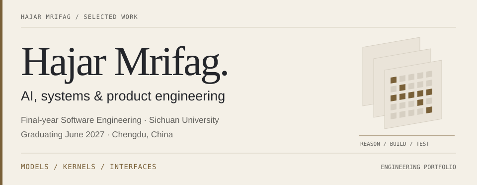
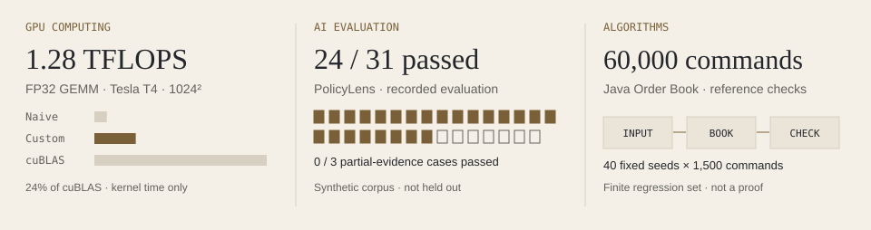
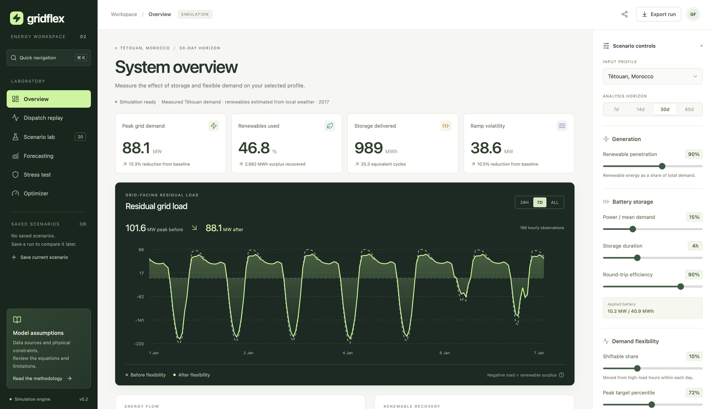
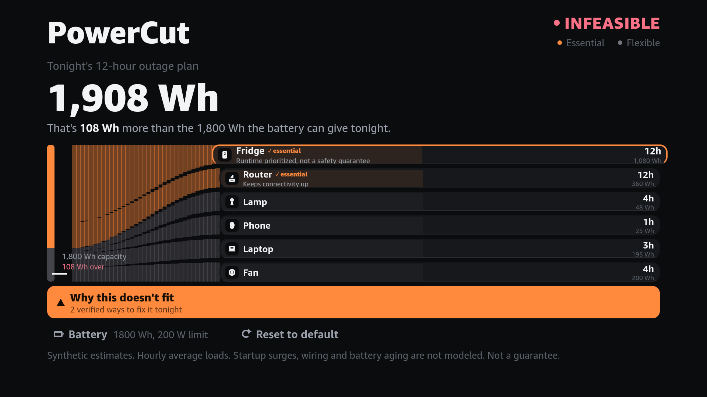

<picture>
  <source media="(max-width: 600px) and (prefers-color-scheme: dark)" srcset="assets/header-mobile-dark.svg">
  <source media="(max-width: 600px)" srcset="assets/header-mobile-light.svg">
  <source media="(prefers-color-scheme: dark)" srcset="assets/header-dark.svg">
  
</picture>

I build intelligent systems and the software around them: models, GPU kernels, algorithms and interfaces. I'm a final-year **Software Engineering student at Sichuan University**, graduating **June 2027**. I like finding the point where a promising idea meets a real constraint—and working through it.

**[Portfolio](https://hajarmrifag.github.io/)** · **[CV](https://hajarmrifag.github.io/assets/Hajar-Mrifag-CV.pdf)** · [Email](mailto:hajarmrifag2@gmail.com) · [LinkedIn](https://www.linkedin.com/in/hajar-mrifag-a7903334b/)

## Selected engineering

<picture>
  <source media="(max-width: 600px) and (prefers-color-scheme: dark)" srcset="assets/evidence-mobile-dark.svg">
  <source media="(max-width: 600px)" srcset="assets/evidence-mobile-light.svg">
  <source media="(prefers-color-scheme: dark)" srcset="assets/evidence-dark.svg">
  
</picture>

### 01 / GridFlex AI

**Energy modelling, numerical optimization and a full-stack workspace.** Explore battery dispatch, flexible demand and chronological forecasts. Removing repeated pandas indexing reduced a recorded 60-day shift + battery workload from **71.731 to 2.246 ms**. This measures the engine; the retrospective optimizer uses perfect foresight.

[Code](https://github.com/hajarmrifag/gridflex-ai) · [Live workspace](https://gridflex.onrender.com/) · [Case study](https://hajarmrifag.github.io/work/gridflex.html) · [Benchmark protocol](https://github.com/hajarmrifag/gridflex-ai/tree/main/benchmarks)

Inside the GridFlex workspace — actual application screenshot

### 02 / CUDA Transformer Kernels

**Follow an optimization from memory access to measurement.** FP32 GEMM reaches **1.28 TFLOPS on a Tesla T4 at 1024 × 1024**, about **3.32× the naive kernel and 24% of cuBLAS**. Register-cached Softmax beats the warp-shuffle experiment at width 2048. Historical kernel timings; current GPU validation changes await a GPU rerun.

[Kernels](https://github.com/hajarmrifag/cuda-transformer-kernels/tree/main/src) · [Results](https://github.com/hajarmrifag/cuda-transformer-kernels/tree/main/results) · [Validation limits](https://github.com/hajarmrifag/cuda-transformer-kernels/blob/main/docs/validation.md)

### 03 / PolicyLens AI

**When retrieval succeeds and the answer still fails.** A document-Q&A prototype with source passages and refusal checks. Expected evidence appeared in the top three for **15/15** evidence-bearing questions; only **24/31** evaluation cases passed. Partial evidence remains **0/3**. Four synthetic documents; refusal calibration used the same questions.

[Code](https://github.com/hajarmrifag/policylens-ai) · [Failure analysis](https://github.com/hajarmrifag/policylens-ai/blob/main/docs/evaluation.md) · [Raw results](https://github.com/hajarmrifag/policylens-ai/blob/main/data/evals/results.json)

### 04 / PowerCut

**Constraint solving you can operate with a TV remote.** A Fire TV / Vega app with an on-device TypeScript solver, independent schedule verification and a Python reference. It explains infeasible backup-power plans and searches for repairs affecting one or two appliances. **231 differential scenarios** check the port; repair optimality is limited to that search scope.

[Code & setup](https://github.com/hajarmrifag/powercut) · [Engine port](https://github.com/hajarmrifag/powercut/blob/main/docs/ENGINE_PORT.md) · [Device measurements](https://github.com/hajarmrifag/powercut/blob/main/docs/ENGINE_BENCHMARKS.md)

Inside PowerCut — actual Vega Virtual Device screenshot

### 05 / Java Order Book

**Price-time priority, with the invariants exposed.** Integer ticks, FIFO queues and cancellation without scanning a price level. **60,000 generated commands** compare behavior with an independent list-based model. One writer owns the in-memory state; JMH records batch timing and allocation costs.

[Matching engine](https://github.com/hajarmrifag/java-order-book) · [Reference-model tests](https://github.com/hajarmrifag/java-order-book/blob/main/src/test/java/dev/hajar/orderbook/ReferenceModelTest.java) · [JMH results](https://github.com/hajarmrifag/java-order-book/blob/main/benchmarks/RESULTS.md)

### 06 / Sourced

**From opportunity search to a considered next step.** At Hong Kong's BUILD ACROSS Hackathon, I built discovery, comparison, browser-local application planning and affordability-scenario UI. Missing evidence stays visible. Teammates owned CV extraction, retrieval and eligibility verification; the README records our contribution boundaries.

[Code & contributions](https://github.com/hajarmrifag/opportunity-compass) · [Architecture](https://github.com/hajarmrifag/opportunity-compass/blob/main/docs/ARCHITECTURE.md)

## Further investigations

- **[Neobank](https://github.com/hajarmrifag/neobank-growth-analytics)** — atomic PostgreSQL transfers and concurrency tests; a separate analytics pipeline over synthetic transactions.
- **[Forensic Evidence Lab](https://github.com/hajarmrifag/forensic-evidence-lab)** — FAT16 and independently sourced NTFS investigations, byte-level cross-checks and evidence-linked reports.
- **[Banking disengagement research](https://github.com/hajarmrifag/churn-reactivation-engine)** — temporal evaluation and a 90-day purge; [FinSight](https://github.com/hajarmrifag/finsight-streamlit) makes the results explorable.
- **[Aegis Claims](https://github.com/hajarmrifag/claims-management-api)** — a React / ASP.NET Core workflow with API-enforced roles, status history and documented security boundaries.

## Research & collaboration

**Data & AI Engineering Intern · Chengdu Suncaper Data · March–April 2026.** In the two-person [SkyQuery project](https://hajarmrifag.github.io/work/skyquery.html), I worked on PySpark/HDFS/Hive analysis over a documented 15M flight records and a separate FastAPI/SQLite query prototype. My teammate owned the frontend and contributed analysis.

**Now:** my AI Study Companion thesis—an adaptive AI tutoring platform and physical robot. Work in progress; implementation and results are not presented here.

I'm interested in **graduate software engineering roles and AI research opportunities**. [Get in touch](mailto:hajarmrifag2@gmail.com).

Measurements describe their recorded workloads, not general performance guarantees. Free-hosted demos may need time to wake.
