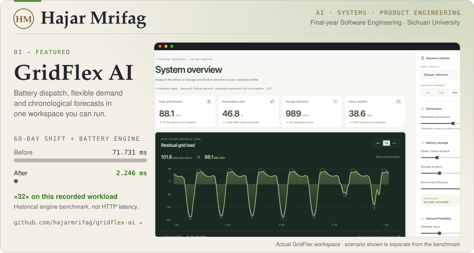
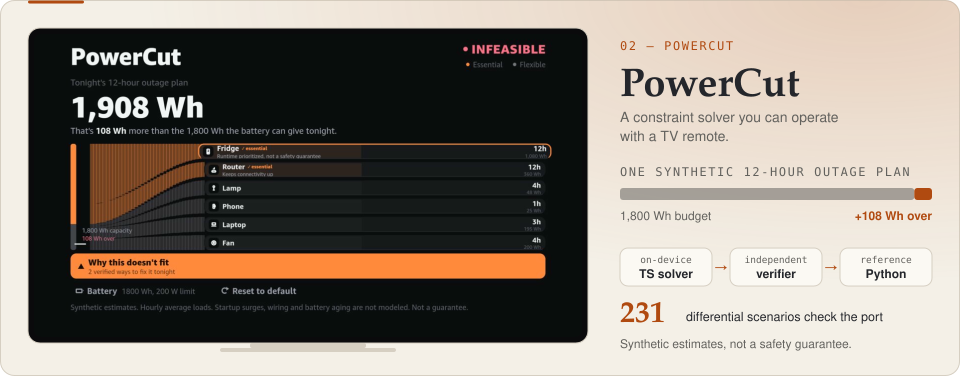
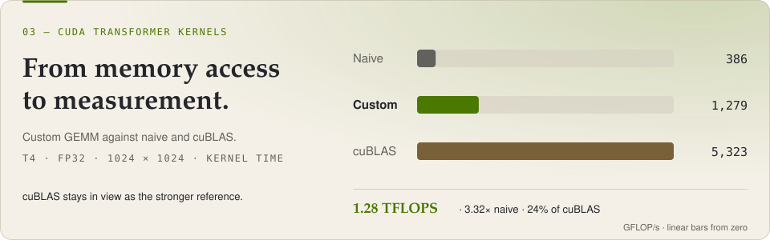
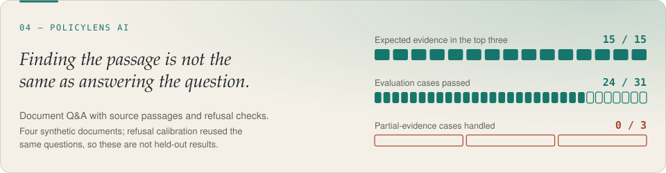
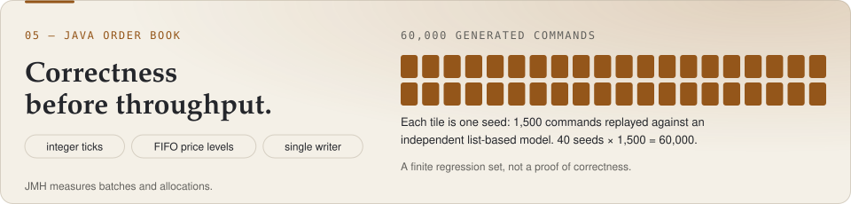
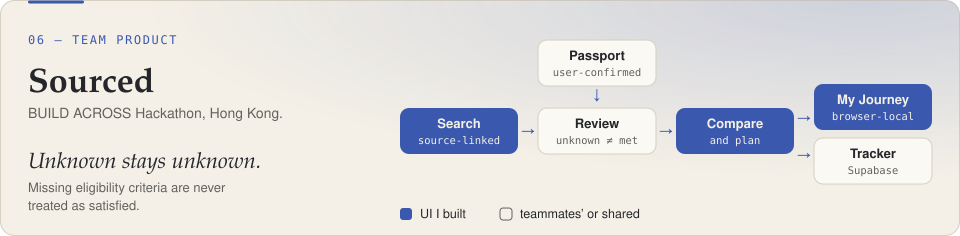

<a href="https://github.com/hajarmrifag/gridflex-ai">
<picture>
  <source media="(max-width: 600px) and (prefers-color-scheme: dark)" srcset="assets/hero-mobile-dark.svg">
  <source media="(max-width: 600px)" srcset="assets/hero-mobile-light.svg">
  <source media="(prefers-color-scheme: dark)" srcset="assets/hero-dark.svg">
  
</picture>
</a>

**[Portfolio](https://hajarmrifag.github.io/)** · **[CV](https://hajarmrifag.github.io/assets/Hajar-Mrifag-CV.pdf)** · **[Contact](mailto:hajarmrifag2@gmail.com)**

Removing repeated pandas indexing cut the recorded **60-day shift + battery engine time** from 71.731 to 2.246 ms. Historical engine benchmark, not HTTP latency; the retrospective optimization assumes perfect foresight. **[Open workspace ↗](https://gridflex.onrender.com/)** · [Methodology](https://github.com/hajarmrifag/gridflex-ai/tree/main/benchmarks)

<a href="https://github.com/hajarmrifag/powercut">
<picture>
  <source media="(max-width: 600px) and (prefers-color-scheme: dark)" srcset="assets/powercut-mobile-dark.svg">
  <source media="(max-width: 600px)" srcset="assets/powercut-mobile-light.svg">
  <source media="(prefers-color-scheme: dark)" srcset="assets/powercut-dark.svg">
  
</picture>
</a>

Makes an infeasible power plan explainable, then searches for a repair. Repairs change one or two appliances; optimality is limited to that scope. **[Engine port & verification](https://github.com/hajarmrifag/powercut/blob/main/docs/ENGINE_PORT.md)**

<a href="https://github.com/hajarmrifag/cuda-transformer-kernels">
<picture>
  <source media="(max-width: 600px) and (prefers-color-scheme: dark)" srcset="assets/cuda-mobile-dark.svg">
  <source media="(max-width: 600px)" srcset="assets/cuda-mobile-light.svg">
  <source media="(prefers-color-scheme: dark)" srcset="assets/cuda-dark.svg">
  
</picture>
</a>

cuBLAS stays the stronger reference; Register-cached Softmax beats the warp-shuffle experiment at width 2048. **[Historical results](https://github.com/hajarmrifag/cuda-transformer-kernels/tree/main/results)**; current GPU validation changes **await a GPU rerun**.

<a href="https://github.com/hajarmrifag/policylens-ai">
<picture>
  <source media="(max-width: 600px) and (prefers-color-scheme: dark)" srcset="assets/policylens-mobile-dark.svg">
  <source media="(max-width: 600px)" srcset="assets/policylens-mobile-light.svg">
  <source media="(prefers-color-scheme: dark)" srcset="assets/policylens-dark.svg">
  
</picture>
</a>

Four synthetic documents; refusal calibration reused the same questions, so these are **not held-out results**. **[Failure analysis](https://github.com/hajarmrifag/policylens-ai/blob/main/docs/evaluation.md)**

<a href="https://github.com/hajarmrifag/java-order-book">
<picture>
  <source media="(max-width: 600px) and (prefers-color-scheme: dark)" srcset="assets/orderbook-mobile-dark.svg">
  <source media="(max-width: 600px)" srcset="assets/orderbook-mobile-light.svg">
  <source media="(prefers-color-scheme: dark)" srcset="assets/orderbook-dark.svg">
  
</picture>
</a>

One writer owns the in-memory state; JMH measures batches and allocations. The 60,000 commands are a **finite regression set**. **[Reference-model tests](https://github.com/hajarmrifag/java-order-book/blob/main/src/test/java/dev/hajar/orderbook/ReferenceModelTest.java)**

<a href="https://github.com/hajarmrifag/opportunity-compass">
<picture>
  <source media="(max-width: 600px) and (prefers-color-scheme: dark)" srcset="assets/sourced-mobile-dark.svg">
  <source media="(max-width: 600px)" srcset="assets/sourced-mobile-light.svg">
  <source media="(prefers-color-scheme: dark)" srcset="assets/sourced-dark.svg">
  
</picture>
</a>

Teammates owned CV extraction, retrieval and eligibility verification. **[Contribution boundaries](https://github.com/hajarmrifag/opportunity-compass#readme)**

---

**About.** Final-year Software Engineering, Sichuan University · graduating June 2027. My AI Study Companion thesis explores adaptive tutoring and a physical robot; implementation and results are not presented here.

**In practice.** Data & AI Engineering Intern, Chengdu Suncaper Data · March–April 2026. On the two-person [SkyQuery project](https://hajarmrifag.github.io/work/skyquery.html): PySpark/HDFS/Hive analysis over a documented 15M flight records and a separate FastAPI/SQLite query prototype. My teammate owned the frontend and contributed analysis.

Open to graduate software engineering roles and AI research opportunities. Free-hosted demos may need time to wake.
