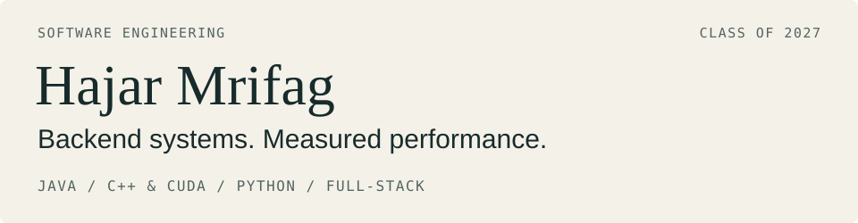

<picture>
  <source media="(max-width: 600px)" srcset="assets/header-mobile.svg">
  
</picture>

I build matching logic, GPU kernels and the applications around them. Final-year **Software Engineering at Sichuan University**, graduating **June 2027**, based in Chengdu and planning to relocate to London.

**[Portfolio & case studies](https://hajarmrifag.github.io/)** · [LinkedIn](https://www.linkedin.com/in/hajar-mrifag-a7903334b/) · [CV](https://hajarmrifag.github.io/assets/Hajar-Mrifag-CV.pdf)

## Start with the engineering

### [Java Order Book](https://github.com/hajarmrifag/java-order-book)
JAVA 21 · ALGORITHMS · JVM

Price-time matching with integer ticks, FIFO queues and cancellation without scanning a price level. **60,000 generated commands** checked against an independent reference model. One writer owns the state; JMH exposes batch timing and allocation costs.

[Design](https://github.com/hajarmrifag/java-order-book/blob/main/docs/design.md) · [Tests](https://github.com/hajarmrifag/java-order-book/tree/main/src/test/java/dev/hajar/orderbook) · [Measured results](https://github.com/hajarmrifag/java-order-book/blob/main/benchmarks/RESULTS.md)

### [CUDA Transformer Kernels](https://github.com/hajarmrifag/cuda-transformer-kernels)
C++17 · CUDA · NSIGHT COMPUTE

**1.28 TFLOPS FP32 GEMM** on a Tesla T4 at 1024 × 1024, about **3.32×** the naive kernel and **24% of cuBLAS**. Register-cached Softmax beat the warp-shuffle experiment at width 2048. The slower experiment stays in the repo because the comparison matters.

[Results](https://github.com/hajarmrifag/cuda-transformer-kernels/tree/main/results) · [Optimization decisions](https://github.com/hajarmrifag/cuda-transformer-kernels/blob/main/docs/optimization.md) · [Validation limits](https://github.com/hajarmrifag/cuda-transformer-kernels/blob/main/docs/validation.md)

## From the engine to the product

**[GridFlex](https://github.com/hajarmrifag/gridflex-ai)** · React / TypeScript / FastAPI / NumPy 
An energy simulation workspace with physical constraints, dispatch replay and scenario comparison. Removing repeated pandas indexing cut a recorded 60-day pipeline from **71.731 to 2.246 ms**. [Case study](https://hajarmrifag.github.io/work/gridflex.html) · [Live app](https://gridflex.onrender.com/) · [Benchmark](https://github.com/hajarmrifag/gridflex-ai/tree/main/benchmarks)

**[Neobank](https://github.com/hajarmrifag/neobank-growth-analytics)** · Python / PostgreSQL / SQL 
Atomic transfers, ordered account locks and serialized retry keys, checked with real-database concurrency and rollback tests. A separate analytics pipeline explores **891,772 synthetic transactions**. [Transaction design](https://github.com/hajarmrifag/neobank-growth-analytics/blob/main/docs/banking-api.md) · [Dashboard](https://neobank-growth-analytics-hajar.streamlit.app/)

**[Aegis Claims](https://github.com/hajarmrifag/claims-management-api)** · C# / ASP.NET Core / React 
A claims workflow with API-enforced roles, status history and validated uploads. Layered services make business rules testable; a documented threat model makes remaining risks inspectable. [Security assessment](https://github.com/hajarmrifag/claims-management-api/blob/main/docs/security/assessment-report.md) · [Live app](https://claims-management-ync9.onrender.com/)

Performance figures describe recorded workloads, not whole-app latency. CUDA's latest validation changes await a GPU rerun. Free-hosted demos may need time to wake.

## Beyond solo projects

**Data & AI Engineering Intern, Chengdu Suncaper Data · March–April 2026** 
Backend and data engineering in the two-person [SkyQuery project](https://hajarmrifag.github.io/work/skyquery.html): PySpark/HDFS/Hive analysis over a documented 15M flight records, plus a separate FastAPI/SQLite query prototype. My teammate owned the frontend and contributed analysis.

**[Sourced](https://github.com/hajarmrifag/opportunity-compass) · BUILD ACROSS Hackathon, Hong Kong · October 2026** 
My contribution connected search, comparison and application follow-through, keeping missing evidence visible and user actions explicit. The README separates my work from teammates' responsibilities.

Also exploring [retrieval evaluation with PolicyLens](https://github.com/hajarmrifag/policylens-ai) and [temporal banking research](https://github.com/hajarmrifag/churn-reactivation-engine).

My foundation is Java/OOP, data structures, operating systems, architecture, networking and distributed systems. I enjoy moving between a usable interface and the constraints underneath it.
