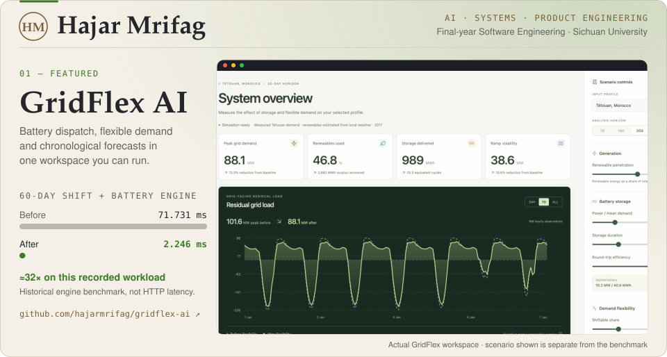
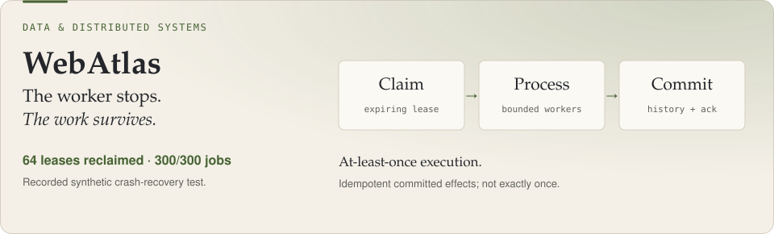
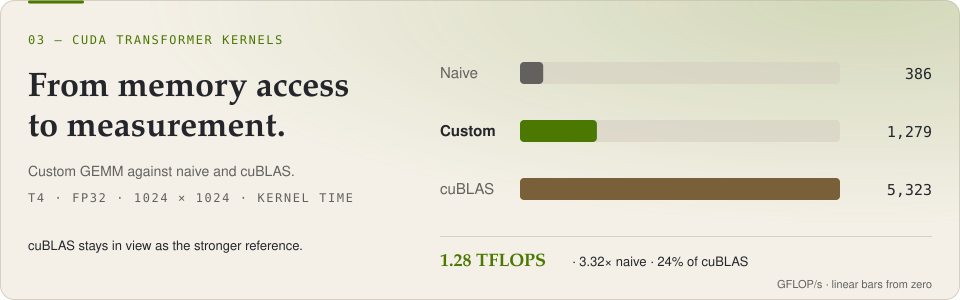
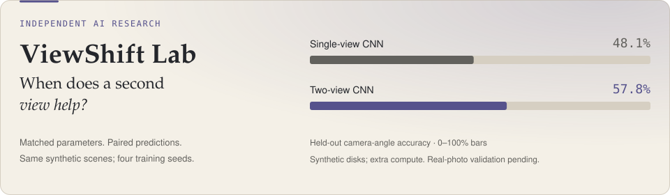
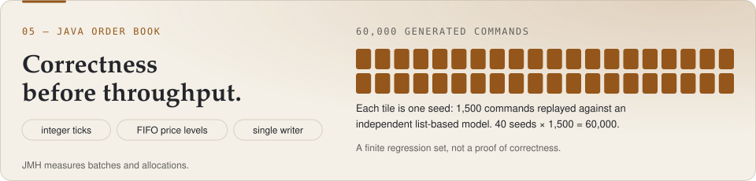
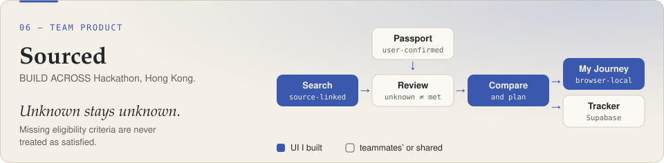
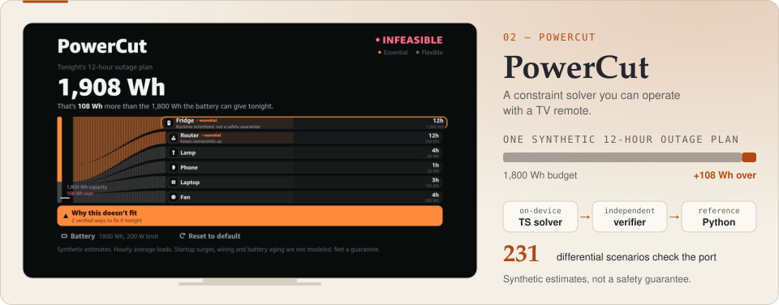
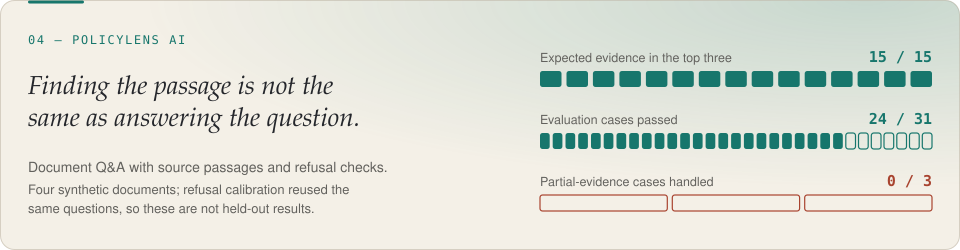

I’m **Hajar Mrifag**, a Software Engineering student at Sichuan University, with expected graduation in June 2027. I build software and data systems, investigate AI/ML questions, and work on algorithms, performance and collaborative products.

**[Portfolio](https://hajarmrifag.github.io/)** · **[CV](https://hajarmrifag.github.io/assets/Hajar-Mrifag-CV.pdf)** · **[Project index](#more-engineering-work)** · **[Contact](mailto:hajarmrifag2@gmail.com)**

## Selected work

[GridFlex](https://github.com/hajarmrifag/gridflex-ai) · [WebAtlas](https://github.com/hajarmrifag/webatlas) · [CUDA kernels](https://github.com/hajarmrifag/cuda-transformer-kernels) · [ViewShift Lab](https://github.com/hajarmrifag/viewshift-lab) · [Java Order Book](https://github.com/hajarmrifag/java-order-book) · [Sourced](https://github.com/hajarmrifag/opportunity-compass)

<a href="https://github.com/hajarmrifag/gridflex-ai">
<picture>
  <source media="(max-width: 600px) and (prefers-color-scheme: dark)" srcset="assets/hero-mobile-dark.svg">
  <source media="(max-width: 600px)" srcset="assets/hero-mobile-light.svg">
  <source media="(prefers-color-scheme: dark)" srcset="assets/hero-dark.svg">
  
</picture>
</a>

**Personal project · full-stack and numerical computing.** I built the React workspace, FastAPI API and simulation engine. The historical 60-day shift + battery workload fell from 71.731 to 2.246 ms; this is engine timing, not application latency. Retrospective optimization assumes perfect foresight. [Benchmark evidence](https://github.com/hajarmrifag/gridflex-ai/tree/main/benchmarks).

<a href="https://github.com/hajarmrifag/webatlas">
<picture>
  <source media="(max-width: 600px) and (prefers-color-scheme: dark)" srcset="assets/webatlas-mobile-dark.svg">
  <source media="(max-width: 600px)" srcset="assets/webatlas-mobile-light.svg">
  <source media="(prefers-color-scheme: dark)" srcset="assets/webatlas-dark.svg">
  
</picture>
</a>

**Personal project · backend and data systems.** PostgreSQL leases coordinate bounded ingestion; observation history and job acknowledgement commit together. A recorded synthetic crash test reclaimed 64 leases and completed 300/300 jobs. At-least-once execution with idempotent committed effects, not exactly once. [Recovery evidence](https://github.com/hajarmrifag/webatlas/blob/main/docs/reliability.md).

<a href="https://github.com/hajarmrifag/cuda-transformer-kernels">
<picture>
  <source media="(max-width: 600px) and (prefers-color-scheme: dark)" srcset="assets/cuda-mobile-dark.svg">
  <source media="(max-width: 600px)" srcset="assets/cuda-mobile-light.svg">
  <source media="(prefers-color-scheme: dark)" srcset="assets/cuda-dark.svg">
  
</picture>
</a>

**Personal project · systems and optimization.** CUDA C++ GEMM and Softmax experiments keep cuBLAS visible as the stronger reference. [Historical T4 results](https://github.com/hajarmrifag/cuda-transformer-kernels/tree/main/results) measure kernel time only. Current GPU validation changes **await a GPU rerun**; raw historical profiler exports were not retained.

<a href="https://github.com/hajarmrifag/viewshift-lab">
<picture>
  <source media="(max-width: 600px) and (prefers-color-scheme: dark)" srcset="assets/viewshift-mobile-dark.svg">
  <source media="(max-width: 600px)" srcset="assets/viewshift-mobile-light.svg">
  <source media="(prefers-color-scheme: dark)" srcset="assets/viewshift-dark.svg">
  
</picture>
</a>

**Independent research · AI/ML and experimental design.** Matched CNN parameters, disjoint scene splits, four training seeds and paired predictions. Mean two-view advantage: +9.7 percentage points on fixed synthetic OOD scenes, with extra input and compute. Projected disks limit interpretation; real-photo validation is pending. [Repeatability and uncertainty](https://github.com/hajarmrifag/viewshift-lab/blob/main/reports/repeatability.md).

<a href="https://github.com/hajarmrifag/java-order-book">
<picture>
  <source media="(max-width: 600px) and (prefers-color-scheme: dark)" srcset="assets/orderbook-mobile-dark.svg">
  <source media="(max-width: 600px)" srcset="assets/orderbook-mobile-light.svg">
  <source media="(prefers-color-scheme: dark)" srcset="assets/orderbook-dark.svg">
  
</picture>
</a>

**Personal project · algorithms and JVM engineering.** One writer owns price-time matching, FIFO queues and cancellation. Twenty tests include 60,000 generated commands checked against an independent model: a finite regression set, not a proof. Educational in-memory system; JMH measures bounded batches, not end-to-end order latency. [Design and results](https://github.com/hajarmrifag/java-order-book#readme).

<a href="https://github.com/hajarmrifag/opportunity-compass">
<picture>
  <source media="(max-width: 600px) and (prefers-color-scheme: dark)" srcset="assets/sourced-mobile-dark.svg">
  <source media="(max-width: 600px)" srcset="assets/sourced-mobile-light.svg">
  <source media="(prefers-color-scheme: dark)" srcset="assets/sourced-dark.svg">
  
</picture>
</a>

**Team hackathon · product development.** Sourced, BUILD ACROSS, Hong Kong, 3–4 October 2026. I built search, persistent comparison, My Journey, Opportunity Brief and affordability-scenario UI. Teammates owned extraction, retrieval and eligibility verification; the finance teammate owned the pure calculator integration. [Contributions and prototype limits](https://github.com/hajarmrifag/opportunity-compass#readme).

## More engineering work

| Project / context | Decision and evidence |
| --- | --- |
| [Aegis Claims](https://github.com/hajarmrifag/claims-management-api) · personal | API role checks, file-signature validation and layered .NET persistence. [22-test record](https://github.com/hajarmrifag/claims-management-api/blob/main/docs/verification-results.md), including real PostgreSQL constraints; no tenant ownership or optimistic concurrency. |
| [Neobank](https://github.com/hajarmrifag/neobank-growth-analytics) · personal | Ordered account locks and idempotent retries. [37-test verification](https://github.com/hajarmrifag/neobank-growth-analytics/blob/main/docs/engineering-verification.md); synthetic funds. Analytics is a separate pipeline. |
| [PowerCut](https://github.com/hajarmrifag/powercut) · Amazon hackathon entry | On-device TypeScript solver, independent verifier and Python reference. Repairs change one or two appliances; optimality is limited to that scope. |
| [PolicyLens](https://github.com/hajarmrifag/policylens-ai) · personal | 15/15 evidence-bearing retrieval cases found the passage; full evaluation passed 24/31, including 0/3 partial-evidence cases. Four synthetic documents; calibration reused questions: not held-out results. |
| [Churn research](https://github.com/hajarmrifag/churn-reactivation-engine) / [FinSight](https://github.com/hajarmrifag/finsight-streamlit) | Purged temporal evaluation and a separate research interface. Historical banking activity is not account closure; campaign effects were not measured. |
| [Quantum Confinement Lab](https://github.com/hajarmrifag/quantum-confinement-lab) · independent research | Numerical eigenproblems checked against matching equations and convergence studies. Idealized 1D physics, not experimental device validation. |
| [Forensic Evidence Lab](https://github.com/hajarmrifag/forensic-evidence-lab) · personal | Binary parsing, integrity hashes and reproducible FAT/NTFS evidence. Artefacts do not establish an actor or authorization. |
| [DevInsight](https://github.com/hajarmrifag/DevInsight) · independent research | Source-linked pipeline over 18 public Vite reports. Exploratory sample, no interviews or prevalence estimates. |

Visual notes: PowerCut and PolicyLens

<a href="https://github.com/hajarmrifag/powercut">
<picture>
  <source media="(max-width: 600px) and (prefers-color-scheme: dark)" srcset="assets/powercut-mobile-dark.svg">
  <source media="(max-width: 600px)" srcset="assets/powercut-mobile-light.svg">
  <source media="(prefers-color-scheme: dark)" srcset="assets/powercut-dark.svg">
  
</picture>
</a>

<a href="https://github.com/hajarmrifag/policylens-ai">
<picture>
  <source media="(max-width: 600px) and (prefers-color-scheme: dark)" srcset="assets/policylens-mobile-dark.svg">
  <source media="(max-width: 600px)" srcset="assets/policylens-mobile-light.svg">
  <source media="(prefers-color-scheme: dark)" srcset="assets/policylens-dark.svg">
  
</picture>
</a>

## Experience & university work

**Internship — Data & AI Engineering, Chengdu Suncaper Data, March–April 2026.** On the two-person [SkyQuery project](https://hajarmrifag.github.io/work/skyquery.html), I owned backend/data engineering: PySpark/HDFS/Hive analysis over a documented 15M flight records and a separate FastAPI/SQLite query prototype. My teammate owned frontend and contributed analysis. The large dataset count does not describe the prototype database.

**University thesis — AI Study Companion.** Explores adaptive tutoring and a physical robot. This is separate from the independent studies above; implementation and results are not presented as public evidence here. [University learning notes and publication scope](https://github.com/hajarmrifag/university-learning-portfolio).

Based in Chengdu, China. Interested in software engineering, AI/ML, data engineering, research and graduate opportunities. **[Explore my portfolio](https://hajarmrifag.github.io/)**.

Free-hosted demonstrations may need time to wake. Measurement records belong to their documented workloads and environments.
